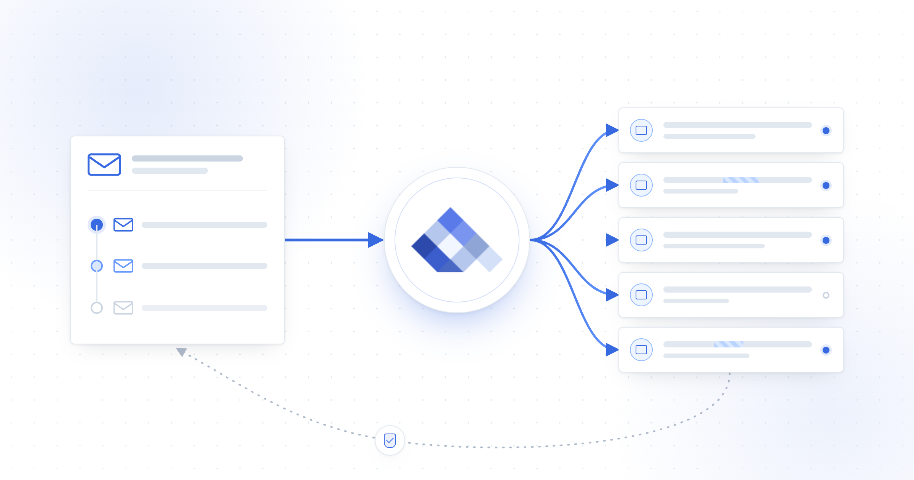
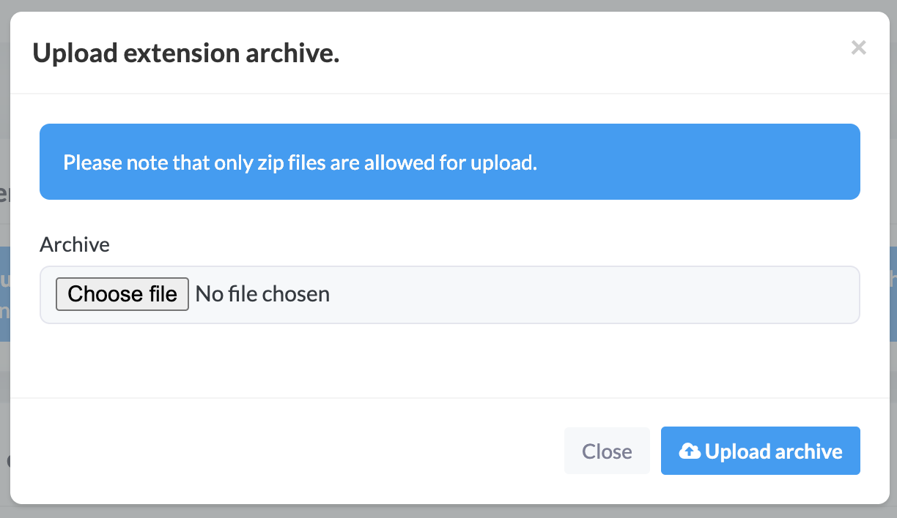
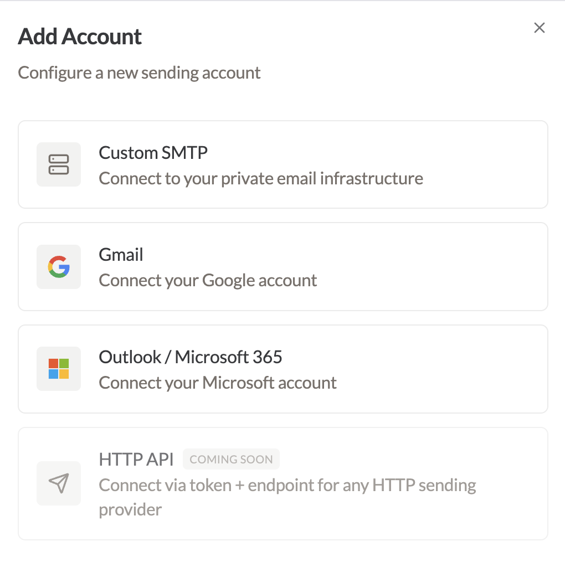
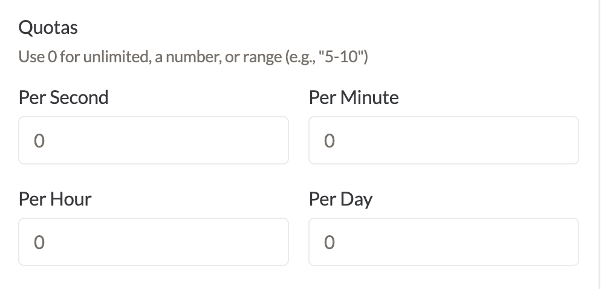
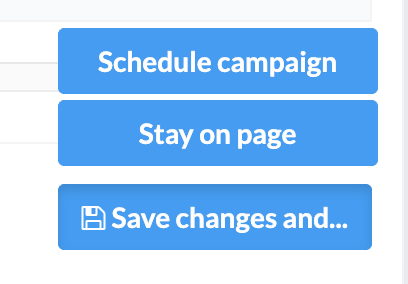

Connect MailWizz to Qubrics when you want MailWizz to manage prospects, campaign content, schedules and follow-ups while Qubrics manages eligible sending accounts, routing and sending limits. You configure one Qubrics delivery server in MailWizz, then use it across your outreach sequence.

<Frame>
  
</Frame>

<Info>
  Before you start, use MailWizz 2.0.34 or later. You also need a Qubrics
  team with an active sending account and a publicly reachable MailWizz
  frontend URL using HTTPS.
</Info>

## Set up MailWizz with Qubrics

<Steps>
  <Step title="Install the extension and connect Qubrics">
    <a href="https://github.com/qubrics/mailwizz-smtp-proxy/releases/latest/download/sendmux-web-api.zip" rel="nofollow noopener noreferrer" target="_blank">Download the latest Qubrics extension</a>. In the MailWizz backend, open **Extend** → **Extensions** → **Upload extension**, upload the archive and enable **Sendmux Sending API**.

    <Frame caption="Upload the Qubrics extension ZIP in MailWizz.">
      
    </Frame>

    In Qubrics, open **API Keys**, create a send-capable mailbox key and copy
    the reveal-once value beginning with `smx_mbx_`.

    In MailWizz, open **Delivery servers** → **Create new**, select **Sendmux
    Web API**, paste the key into **Sending Key** and complete the sender
    fields. Save the server. It remains inactive until you connect signed
    feedback.

    Reopen the server and select **Info** to copy its webhook URL. In Qubrics,
    open **Webhooks** → **Create webhook**, use that URL and subscribe to
    `message.bounced` and `message.complained`. Copy the reveal-once `whsec_`
    secret back into **Webhook signing secret** in MailWizz. Save, test and
    activate the delivery server.
  </Step>

  <Step title="Add sending accounts and set limits">
    In Qubrics, open **Accounts** → **Add Account**. Add each account you want
    in your outreach pool, complete its connection details and run the
    available test.

    <Frame caption="Choose the connection type for each Qubrics sending account.">
      
    </Frame>

    Set accurate From and Reply-To details for each account. Then configure
    fixed limits or minimum-to-maximum ranges for supported per-second,
    per-minute, per-hour and per-day windows.

    <Frame caption="Set fixed or ranged quotas for each sending window.">
      
    </Frame>

    Choose limits that fit the account's history and provider policy. A range
    such as `5–10` lets Qubrics periodically select an active cap inside those
    boundaries. Messages above the current cap wait until capacity is
    available.
  </Step>

  <Step title="Start the campaign and follow-ups">
    Create a regular MailWizz campaign for your prospect list. Choose the
    audience, write the message and complete the normal scheduling steps.

    <Frame caption="Use MailWizz's campaign actions to schedule or save your work.">
      
    </Frame>

    Build each follow-up as a separate MailWizz autoresponder campaign,
    triggered after the original campaign is sent or opened. Set the delay and
    time unit deliberately, then read the full sequence as the recipient
    before activation.

    Use a separate campaign for every intended follow-up. Both the original
    campaign and its follow-ups use the same Qubrics delivery server, so
    account eligibility and sending limits continue to apply.
  </Step>
</Steps>

<Warning>
  Send only to people you may lawfully contact. Keep your targeting relevant,
  identify the sender accurately, honour suppression records and provide a
  clear way to stop further contact.
</Warning>

## How MailWizz and Qubrics divide the work

MailWizz owns the campaign workflow. Qubrics decides which eligible account can send and enforces that account's current limits. This keeps lists and automations in MailWizz without recreating every sending account as a separate delivery server.

| MailWizz | Qubrics |
| --- | --- |
| Lists, subscribers and segments | Connected sending accounts |
| Campaign content and schedules | Account eligibility and routing |
| Autoresponder conditions and delays | Per-second, minute, hour and day caps |
| Campaign bounce and complaint actions | Signed bounce and complaint events |

## Choose fixed limits or ranges

Use a fixed cap when you want one predictable ceiling. Use a range when the active ceiling may move within approved boundaries. Qubrics selects a value when account information refreshes and keeps that cap until the next refresh.

A range varies the sending ceiling. It does not add a random delay to each message or guarantee inbox placement. Good targeting, authenticated sender domains, relevant content and a healthy account history still matter.

## How feedback returns to MailWizz

The extension includes MailWizz campaign and subscriber identifiers with campaign sends. When Qubrics reports a bounce or complaint, MailWizz verifies the signed event and matches it to the campaign, subscriber and delivery server that recorded the send before changing subscriber state.

| Qubrics event | MailWizz result |
| --- | --- |
| Permanent bounce | Records a hard bounce and normally blacklists the subscriber. |
| Transient bounce | Records a soft bounce. |
| Undetermined bounce | Records an internal bounce. |
| Complaint | Applies MailWizz feedback handling and blacklists the subscriber. |

Invalid, unsigned or unmatched webhook calls cannot alter campaign records. If a later bounce has a stronger classification, the extension preserves that stronger result.

## What `queued` means

`queued` means Qubrics accepted the message for processing. It does not mean the recipient system accepted it or that it reached the inbox. Final delivery still depends on the selected account, the recipient system, message quality and sender reputation.

## Check before your first campaign

- Test and activate the Qubrics delivery server in MailWizz.
- Confirm at least one eligible sending account is active.
- Review From, Reply-To and sending limits for every account.
- Confirm the feedback webhook has its saved `whsec_` secret.
- Check prospect sourcing, suppression and opt-out handling.
- Read the original campaign and every follow-up from start to finish.

Start with a controlled campaign. Check delivery logs, bounces, complaints and replies before you raise volume.

## Common questions

<AccordionGroup>
  <Accordion title="Do I need a separate MailWizz bounce server?">
    Not for campaign feedback handled by this integration. The signed webhook
    writes correlated bounces and complaints into MailWizz. Keep it active and
    monitor failed webhook deliveries in Qubrics.
  </Accordion>

  <Accordion title="Can Qubrics use multiple sending accounts?">
    Yes. Add each account to Qubrics and configure its sender details, limits
    and routing. Qubrics chooses among eligible active accounts for the key
    used by the MailWizz delivery server.
  </Accordion>

  <Accordion title="Why is the delivery server inactive?">
    A new server remains inactive until its webhook signing secret is saved.
    MailWizz also deactivates it after a credential change so you can test the
    new configuration before campaigns use it.
  </Accordion>

  <Accordion title="Can I reuse one autoresponder for repeated sends?">
    Use a separate MailWizz campaign for each intended follow-up. Deliberately
    re-entering the same subscriber into the same autoresponder during the
    Qubrics idempotency window is not supported.
  </Accordion>
</AccordionGroup>

## Related guides

<Columns cols={2}>
  <Card title="Sending accounts" icon="envelope" href="/sending/accounts">
    Add accounts and configure sender defaults, limits and routing.
  </Card>
  <Card title="Delivery groups" icon="route" href="/sending/accounts/delivery-groups">
    Keep selected sending accounts together for a chosen traffic stream.
  </Card>
  <Card title="Dashboard and logs" icon="scroll" href="/monitoring/dashboard-logs">
    Review message status and investigate delivery activity.
  </Card>
  <Card title="Deliverability" icon="shield-check" href="/monitoring/deliverability">
    Monitor bounce rates, complaint rates and account health.
  </Card>
</Columns>
